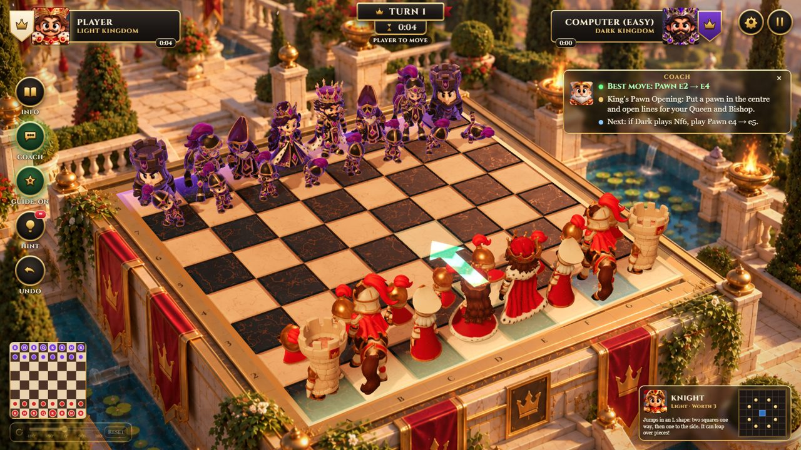
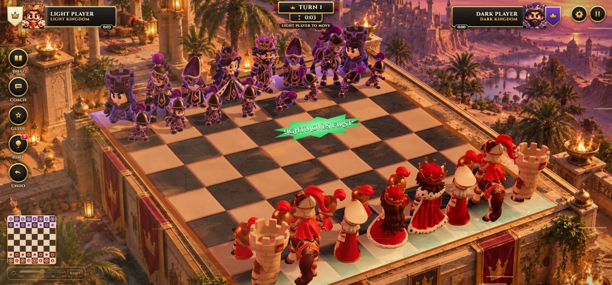
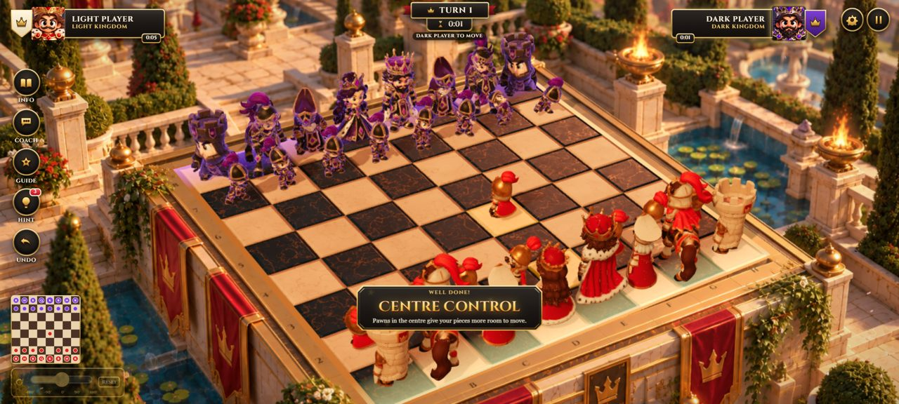
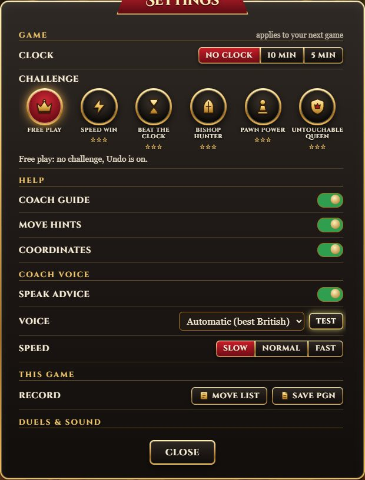

# Chess Masters

A chess game for ages 7 to 16, played in hand-painted 3D arenas. Every capture is a short cartoon duel, a coach explains strategy as you play (and can read its advice aloud), and named openings, forks, pins and checkmates earn "Well done!" badges.



## Features
- **Five arenas:** Palace Gardens, Dark Kingdom, Frozen Kingdom, Jungle Temple and Arabian Palace. Each is a painting with a 3D board fitted to its perspective, and each has its own weather: petals, embers, blizzards, falling leaves and sand blasts.
- **12 animated characters** with their own walks, attacks (bishops cast fireballs), celebrations and defeats. The losing king waves a white flag.
- **Coach and Guide:** the best move with a short plan two moves ahead, warnings before risky moves, real opening names, and a speaking coach using the device's own voices.
- **Play the computer** (four levels) **or a friend** on the same screen, with optional clocks and challenges.
- **Kid-friendly feedback:** comic pop-up words, cheers and clangs, invalid moves explained, a minimap and a board that turns in 90-degree steps.
- **Works on phones** held sideways.

| Arabian Palace | Phone | Settings |
|---|---|---|
|  |  |  |

## Running it
You need [Node.js](https://nodejs.org) (the LTS version).

```bash
npm install
npm run dev      # play at http://localhost:5173 with live reload
npm run build    # production build into dist/ (a static site: any web host can serve it)
npm test         # unit tests
```

The intro video lives at `public/assets/video/intro.mp4`. On the author's PC, `PLAY CHESS MASTERS.bat` (kept outside this repository) also copies a new intro video in from an `INTRO VIDEO` folder.

## How it is built
TypeScript, [three.js](https://threejs.org) and Vite; chess rules by chess.js; a custom engine running in a Web Worker for the computer opponent and the coach. All sound and music is synthesised in code. See [docs/README.md](docs/README.md) for how the parts fit together and [docs/licences.md](docs/licences.md) for third-party licences.

## Rights
The artwork, characters, models, animations, arena paintings, menu screens and intro video are © Harry Hadjiyerou. All rights reserved: they may not be reused without permission. Third-party code libraries keep their own licences (listed in docs/licences.md).
